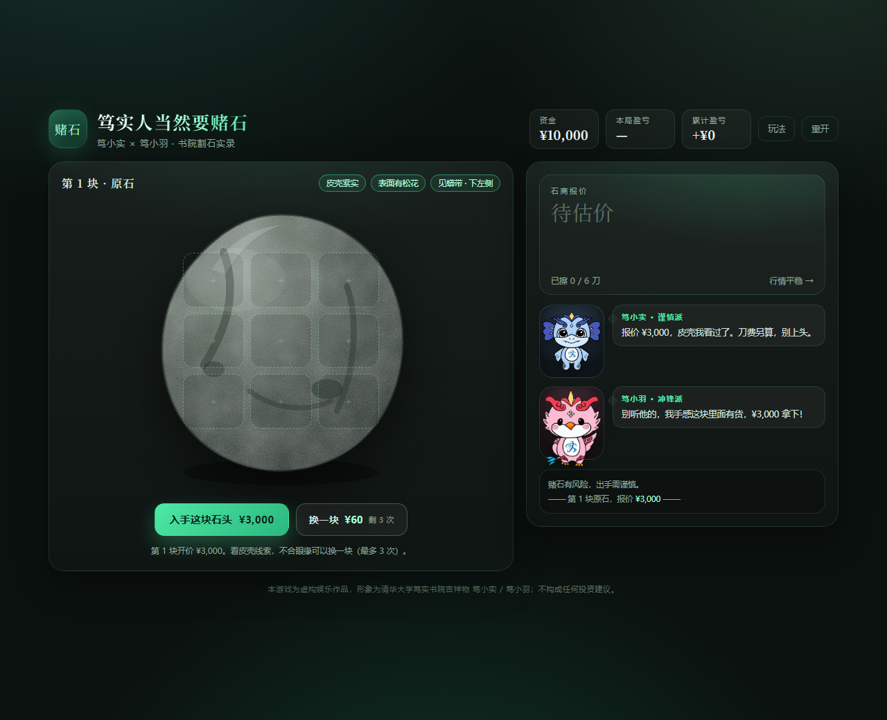
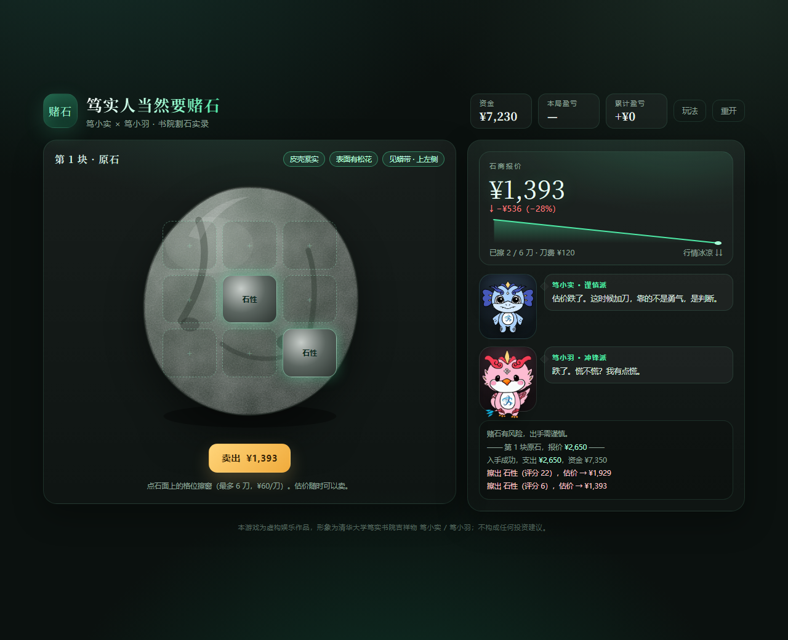
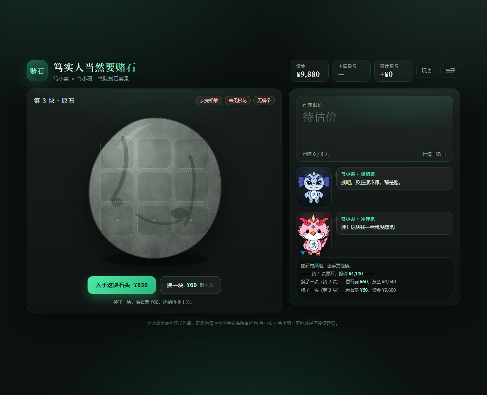
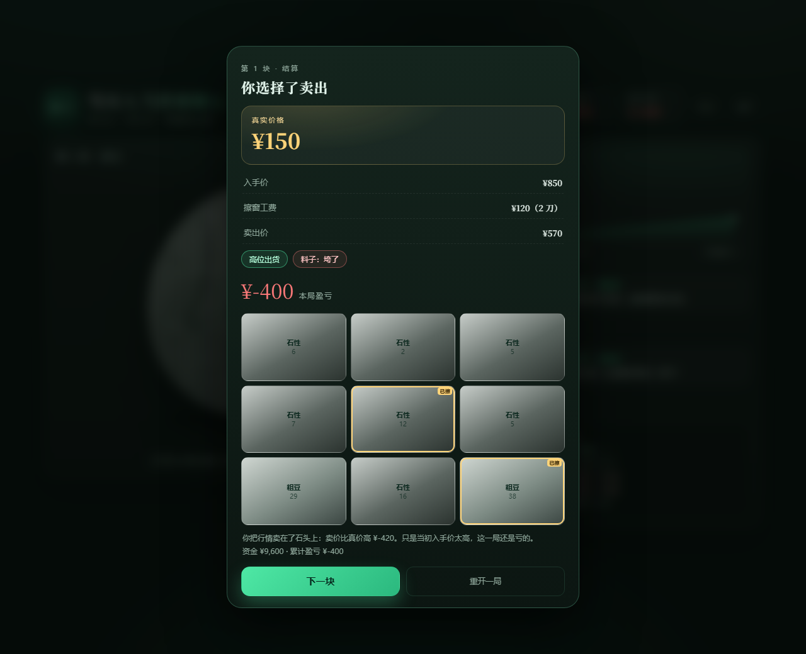

<div align="center">

# 笃实人当然要赌石

**笃小实 × 笃小羽 · 书院割石实录**

看皮壳、换石头、擦窗探玉脉 —— 在行情最高处把石头卖出去，然后才知道自己到底赌赢没赌赢。

单文件 · 零依赖 · 打开即玩



</div>

---

## 在线试玩

**<https://rainjin107.github.io/dushiaidushi/>**

> 仓库：[RainJin107/dushiaidushi](https://github.com/RainJin107/dushiaidushi) · GitHub Pages 托管

## 玩法

一局一块**原石**，三步走：

1. **看皮壳** —— 「皮壳紧实 / 表面有松花 / 见蟒带 · 上左侧 / 皮壳见细裂」，都是与成色弱相关的线索；
2. **擦窗** —— 石面 9 格，最多擦 **6 刀**（¥60/刀）。玉脉是一条斜穿石面的**蟒带**，擦在不同位置看到的料子完全不同；
3. **卖出** —— 随时可以卖，卖价就是石商**当下报价**；擦满 6 刀石头被擦穿，必须出手。

卖出后公布**真实价格**，结算 `卖出价 − 入手价 − 刀费 = 本局盈亏`，并给出「高位出货 / 卖在真价附近 / 卖飞了」的判定。

### 核心机制

| 机制 | 说明 |
| --- | --- |
| 以窗推石 | 石商不是按你这一窗给钱，而是按已知窗口推算整块石头的成色；刀数越多、位置越关键，报价越接近真相 |
| 近因情绪 | 石商有近因偏差：刚擦出好窗报价容易虚高，连擦两刀废窗行情就一路凉下去 —— **报价高点常出现在"刚擦出好窗"那一刻** |
| 换一块 | 不合眼缘可以换石，¥60/次，**每块最多换 3 次**；换来换去，好料子的价也会被抬高 |
| 情绪台词 | 笃小实（谨慎派）负责算账，笃小羽（冲锋派）负责上头，两人的台词会随擦窗结果与报价涨跌实时变化 |

<div align="center">

</div>

<div align="center">

</div>

## 数值平衡

不是拍脑袋定的：写了一个不依赖浏览器的 DOM 模拟器，对几万块石头做蒙特卡洛，把「擦一刀就卖能稳定套利」「随机点导致中心格永远最优」这类漏洞逐个修掉，并校准了报价系数。

| 打法 | 平均盈亏 | 盈利率 |
| --- | --- | --- |
| 随机擦 1 刀就卖 | ≈ ¥0（公平） | ~33% |
| 随机擦 6 刀 | ≈ ¥0（公平） | ~31% |
| 跟着蟒带线索擦、见好就收 | **+¥131/块（约 +9%）** | ~42% |
| 加上换石（换到有蟒带线索） | **+¥330/块（约 +22%）** | ~45% |

石头池子里约 **14%** 的料子真实价值 ≥ 2 倍报价（大涨），约 **37%** ≤ 0.5 倍（半垮）。乱擦不赚不亏，会读蟒带 + 会择时才赚钱；贪心多擦几刀会被刀费吃掉利润。

<div align="center">

</div>

## 本地运行

纯静态，双击 `index.html` 即可。若想用本地服务器（推荐，避免某些浏览器对 `file://` 的限制）：

```bash
python -m http.server 8000
# 打开 http://localhost:8000
```

## 部署到 GitHub Pages

### 方式一：Actions 自动部署（推荐）

仓库已附带 `.github/workflows/pages.yml`。推送到 `main` 后：

1. 打开仓库 **Settings → Pages**；
2. 在 **Build and deployment → Source** 选择 **GitHub Actions**；
3. 之后每次 push 都会自动发布，几分钟后即可访问 `https://<用户名>.github.io/<仓库名>/`。

### 方式二：从分支直接发布

**Settings → Pages → Source** 选 **Deploy from a branch**，分支选 `main`，目录选 `/ (root)`，保存即可。

### 上传仓库

```bash
git init
git add .
git commit -m "feat: 笃实人当然要赌石"
git branch -M main
git remote add origin https://github.com/<你的用户名>/<仓库名>.git
git push -u origin main
```

> 没有命令行 git 也可以：在 GitHub 网页上 **New repository** → **uploading an existing file**，把整个目录拖进去。

## 仓库结构

```text
.
├── index.html                # 游戏本体（图片已 base64 内嵌，可单文件分发）
├── favicon.png               # 站点图标（笃小实头像）
├── apple-touch-icon.png
├── assets/                   # 形象素材（透明底 PNG + WebP），供二次使用
│   ├── dushi-shi-transparent.png
│   ├── dushi-shi.webp
│   ├── dushi-yu-transparent.png
│   └── dushi-yu.webp
├── preview/                  # README / 分享用截图
├── .github/workflows/        # GitHub Pages 自动部署
├── .nojekyll                 # 跳过 Jekyll 处理
├── .gitignore
├── LICENSE
└── README.md
```

## 自定义与调参

所有数值都在 `index.html` 顶部的几个常量里，改完刷新即可：

| 常量 | 含义 | 默认 |
| --- | --- | --- |
| `CFG.startCash` | 初始资金 | `10000` |
| `CFG.maxCuts` / `cutFee` | 擦窗上限 / 每刀费用 | `6` / `60` |
| `CFG.swapFee` / `maxSwaps` | 换石费用 / 每块最多换几次 | `60` / `3` |
| `TUNE.vA / vB / vExp` | 料子价值曲线（决定大涨与垮料的分布） | `0.10 / 4.6 / 1.9` |
| `TUNE.hintNoise` | 蟒带方位提示的噪声（越大越不可靠） | `0.50` |
| `TUNE.hintPrem` | 每条好线索带来的报价溢价 | `380` |
| `TUNE.rho` | 石商"以窗推石"的推演强度（越小越容易被看穿） | `0.18` |
| `CONF` | 不同刀数下的报价系数（已按模拟校准） | `1.005…1.059` |

想要更刺激：把 `hintNoise` 调到 `0.8`、`vExp` 调到 `2.2`；想要更温和：把 `vExp` 降到 `1.6`、`maxCuts` 降到 `4`。

## 技术说明

- 纯 HTML / CSS / JavaScript，**无框架、无构建、无网络请求**；
- 石头纹理用内联 SVG `feTurbulence`，翡翠窗用渐变 + 光晕；
- 角色形象抠图后以 WebP base64 内嵌，保持单文件可分发；
- 桌面双栏 / 手机单列自适应；
- 开发期用 Node 搭了 DOM 模拟器做全流程回归（换成、擦窗、强制出手、破产收工、账目恒等式）。

## 浏览器支持

Chrome / Edge / Firefox / Safari 近两年版本均可（用到 CSS Grid、`aspect-ratio`、WebP、`backdrop-filter`）。

## 版权与声明

- **代码**：以 [MIT](LICENSE) 协议开源。
- **角色形象**：「笃小实」「笃小羽」为**清华大学笃实书院**的吉祥物，其著作权归版权方所有。本项目为**非官方**的粉丝向学习/娱乐作品，形象素材仅用于角色展示与氛围营造，**不在 MIT 许可范围内，请勿商用**；如版权方有任何异议，可随时移除相关素材。
- **声明**：游戏内的一切价格、行情与盈亏均为虚构数值，**不构成任何投资建议**；赌石有风险，现实中的赌石请勿参与。

<div align="center">

[](https://github.com/deepseek-ai/deepseek-harness)

</div>
